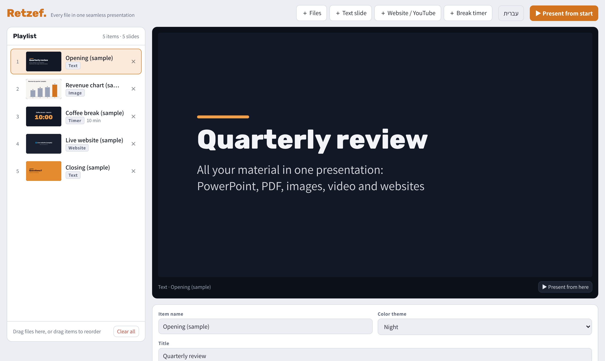
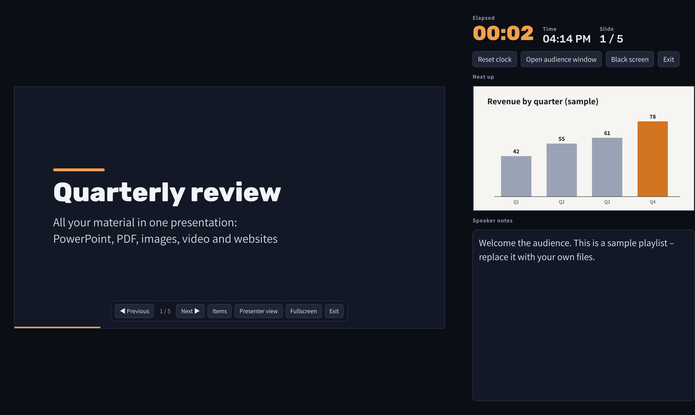
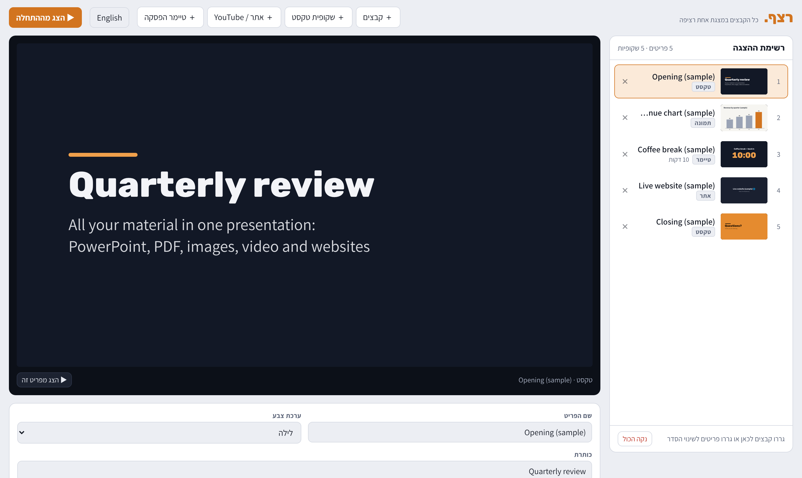

# Retzef — one seamless presentation

**Stop alt-tabbing in front of your audience.** Retzef turns a pile of PowerPoint decks, PDFs, videos, images, live websites, YouTube clips, text slides and break timers into a *single* continuous playlist — and plays it edge to edge, with no desktop, no "please wait", no fumbling between apps.

> Retzef (רצף) is Hebrew for *sequence* — because that is exactly what it gives your talk.

The interface is fully bilingual: **English by default, Hebrew (RTL) one click away.**

---

## Screenshots

**The control room** — build your run of show: drag files in, reorder, preview, and hit present.



**Presenter view** — current slide, what's next, speaker notes and timers on your screen; the audience sees only the show.



**One click to Hebrew (RTL)** — the whole interface flips, and your choice is remembered.



---

## Why Retzef

- **Everything in one run of show.** Drag in `.pptx`, `.pdf`, `.mp4`, images, a URL, a YouTube link — reorder by dragging — and present them as one deck.
- **Real PowerPoint, when it matters.** The Windows app plays `.pptx` files *inside the PowerPoint installed on your machine*, so animations, transitions, embedded video, fonts and SmartArt look exactly as designed. (This is the same approach SlideDog uses.)
- **Works in the browser too.** No install required — a single self-contained HTML file renders PowerPoint, PDF and the rest right in the browser.
- **A real presenter view.** Current slide, next slide, speaker notes, elapsed timer and wall clock — on your screen, while the audience sees only the show.
- **Two-screen aware.** The audience window opens automatically on the projector; your laptop stays on the presenter console, and your clicker keeps driving everything.
- **Break timers, text slides and live web pages** — built in, no extra tooling.
- **Your files never leave your machine.** The playlist is stored locally in your browser; nothing is uploaded.

---

## Two editions

| | Browser edition | Windows app |
|---|---|---|
| Install | None — open one HTML file | Unzip and run, or install |
| PowerPoint rendering | Built-in renderer (animations & transitions supported) | **The installed PowerPoint** — pixel-identical to the original |
| Audience window | ✓ (from a local file) | ✓ |
| Best for | Quick use anywhere | Talks where the deck must look perfect |

---

## Quick start — Windows app (no install)

1. Unzip `Retzef-1.1.0-win-x64.zip`.
2. Run `Retzef.exe`. On first launch Windows SmartScreen may warn that the file is unsigned: **More info → Run anyway**.
3. The bottom of the playlist should show **"PowerPoint 16 connected"**.

**Requirements:** Windows 10 or 11 (64-bit). Microsoft PowerPoint (Microsoft 365, 2021, 2019 or 2016) for native playback — without it, the app still runs and falls back to the built-in viewer.

## Quick start — browser edition

Open `src/retzef.html` directly in your browser. That's it. (Opening it as a local file — rather than inside an embedded preview — also enables the pop-out audience window.)

---

## During a show

- **Two screens (laptop + projector):** the audience window opens on the second display. When you reach a PowerPoint item, it opens full-screen in PowerPoint on the projector while Retzef stays on your laptop as the presenter console. Your clicker/keyboard keep talking to Retzef, and Retzef forwards every click to PowerPoint.
- **One screen:** PowerPoint opens on top of Retzef and takes the keys directly.
- At the end of a deck, Retzef advances to the next item automatically. **Previous** on the first slide steps back to the previous item.
- `Esc` inside PowerPoint closes the deck; **Next** continues.
- You can switch any file to the **built-in viewer** at the bottom of the list.

**Keys:** `→`/`Space`/`PgDn` next · `←`/`PgUp` previous · `P` presenter view · `G` quick jump · `B` black screen · `F` fullscreen · `Esc` exit.

---

## Build an installer (on Windows)

Requires Node.js 20+.

```bat
npm install
npm run dist
```

Output lands in `dist/`: an installer (`Retzef-Setup-1.1.0.exe`) and a portable build (`Retzef-Portable-1.1.0.exe`). For development: `npm start`.

---

## Project structure

| File | Role |
|---|---|
| `src/retzef.html` | The player itself — the same file serves as the browser edition |
| `build/prepare.js` | Builds `app/index.html`: swaps CDN loads for local copies (pdf.js, pptx-preview, JSZip, fonts) so the app runs offline |
| `main.js` | Electron process: windows, audience screen, driving PowerPoint |
| `preload.js` | Bridge between the page and the app (`window.retzefDesktop`) |
| `ppt-host.ps1` | Controls PowerPoint through Windows COM automation |
| `fake-ppt.js` | A PowerPoint simulator for development and tests on machines without PowerPoint |

---

## Notes

- Files never leave your computer. A copy of each deck is kept in the app's data folder (`%APPDATA%\Retzef\presentations`) and removed when you remove it from the list.
- During a show Retzef temporarily sets PowerPoint's "slide show monitor" and restores it afterward.
- Web pages are shown inside the app even when the site blocks embedding elsewhere.

## Language

The UI ships in **English by default**; use the **עברית / English** toggle in the header to switch (your choice is remembered). Hebrew documentation: [README.he.md](README.he.md).
